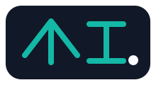

<p align="center"></p>
<p align="center"></p>
<p align="center"><a href="LICENSE"></a>   </p>
<p align="center"></p>

## 🧭 Overview
A local-first playground for learning how IntersectionObserver reports elements entering and leaving a viewport. Experiment with root margins and thresholds without editing code.

## ✨ Features
- 🧭 Change rootMargin and threshold from the page controls
- 📈 Inspect isIntersecting and intersectionRatio for each target
- 🧪 Observe multiple targets while scrolling through the page

## 🎬 Demo
Run the local app and scroll through the observation cards. No hosted demo is claimed.

## 🚀 Quick Start
```bash
npm start
```
Open http://localhost:4173.

## 🧰 Tech Stack
- 🧩 Node.js static server and browser JavaScript
- 🔒 Local execution; no account or API key
- 📦 No runtime dependencies

## 🗂️ Folder Structure
```text
browser-intersection-observer-lab/
├── assets/mark.svg
├── public/{index.html,styles.css,app.js}
├── server.js
├── package.json
├── .gitignore
├── LICENSE
└── README.md
```

## 🛣️ Roadmap
- [ ] Add a custom scroll-root container mode
- [ ] Export observation logs as JSON

## 🤝 Contributing
Issues and pull requests are welcome. Keep examples reproducible and document browser support.

## 📄 License
Released under the [MIT License](LICENSE).

<p align="center"></p>
